# Σ Sistema de Contabilidad

Sistema contable de **partida doble** con Python y PostgreSQL: catálogo de cuentas jerárquico, pólizas que la propia base de datos valida (debe = haber), libros diario y mayor, balanza de comprobación, balance general, estado de resultados, cuentas por cobrar y por pagar con antigüedad de saldos, facturas con IVA y retenciones que generan su asiento solas, multimoneda con diferencia cambiaria, cierre de periodos y conciliación bancaria con importación de CSV.


<p align="center">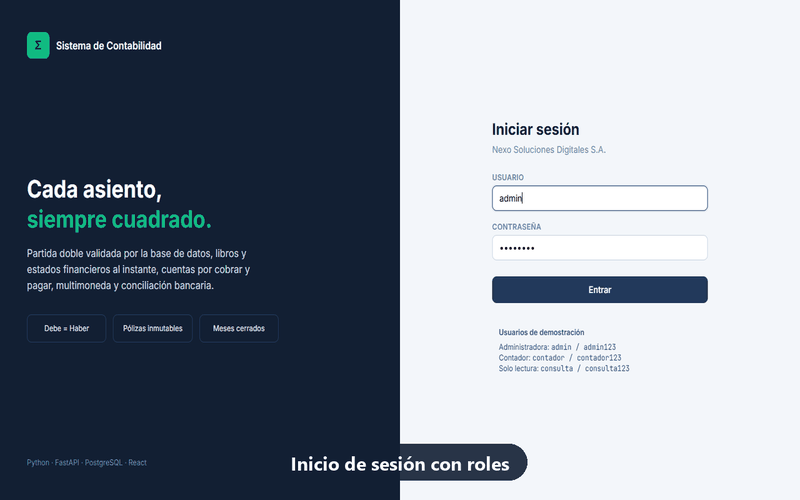</p>
<p align="center"><a href="docs/video/recorrido-contabilidad.mp4"><b>▶ Ver el video completo (MP4)</b></a> · <a href="docs/COMO-SE-HIZO.md"><b>📘 Cómo se hizo, paso a paso</b></a></p>

## 📸 Capturas

| Resumen | Captura ágil de pólizas |
|---|---|
| 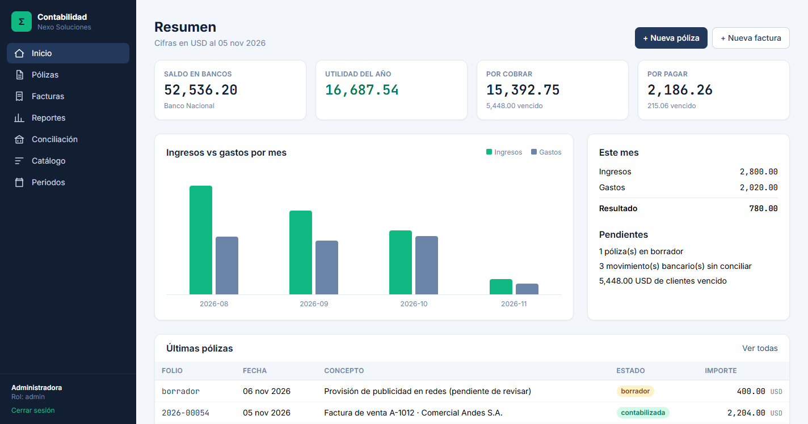 | 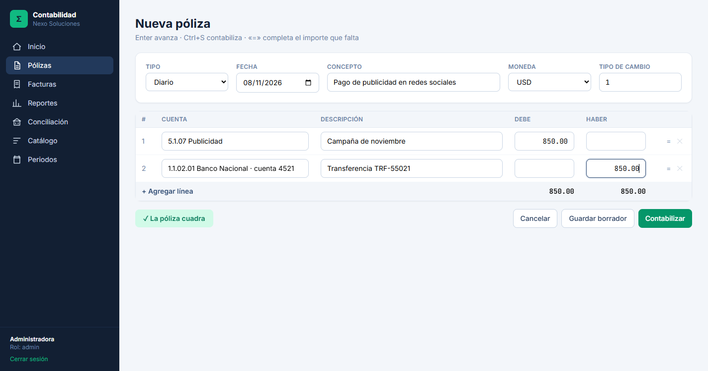 |
| **Balance general (cuadrado)** | **Conciliación bancaria** |
| 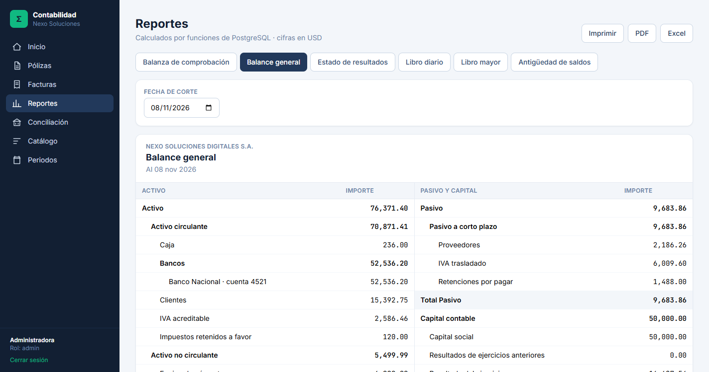 | 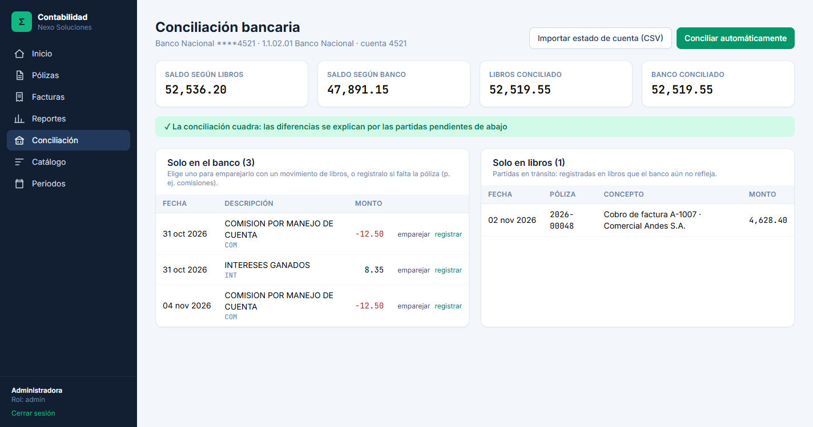 |

<details>
<summary><b>Ver más capturas</b></summary>

| | |
|---|---|
| 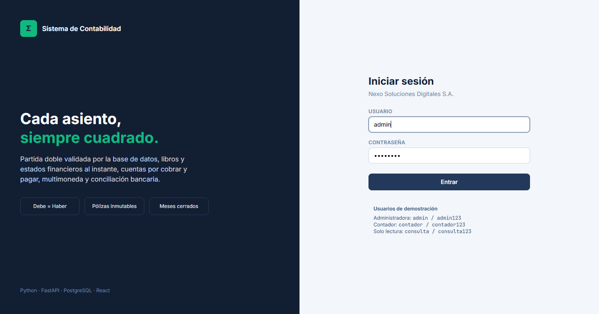 | 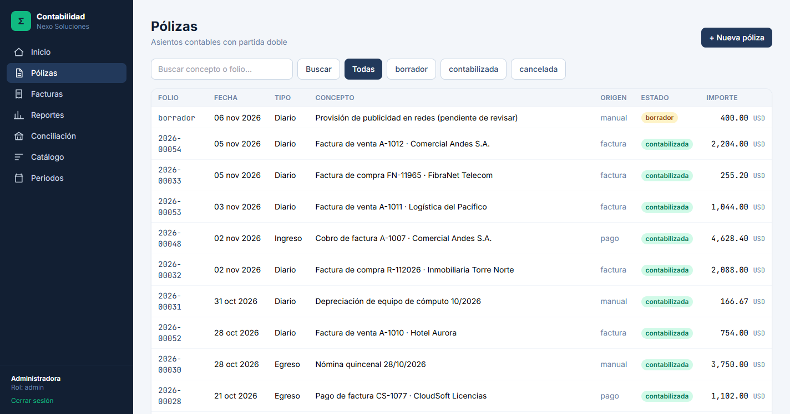 |
| 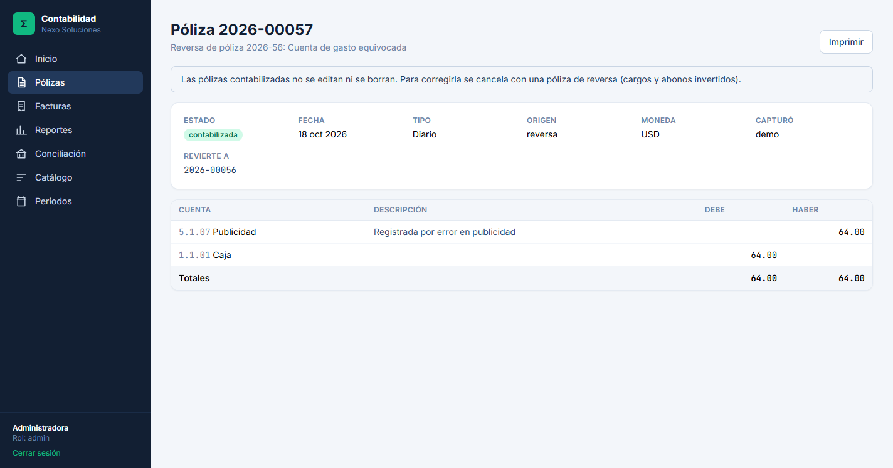 | 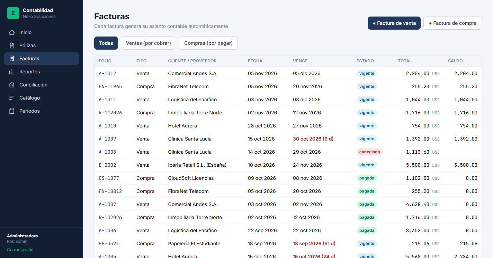 |
| 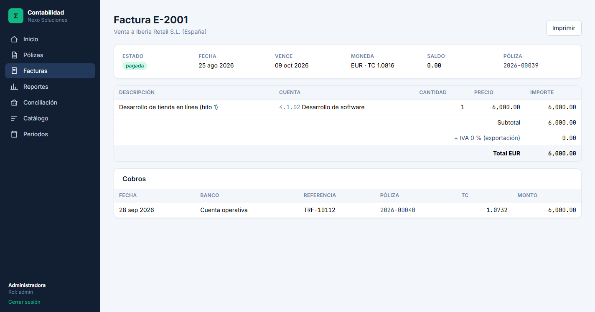 | 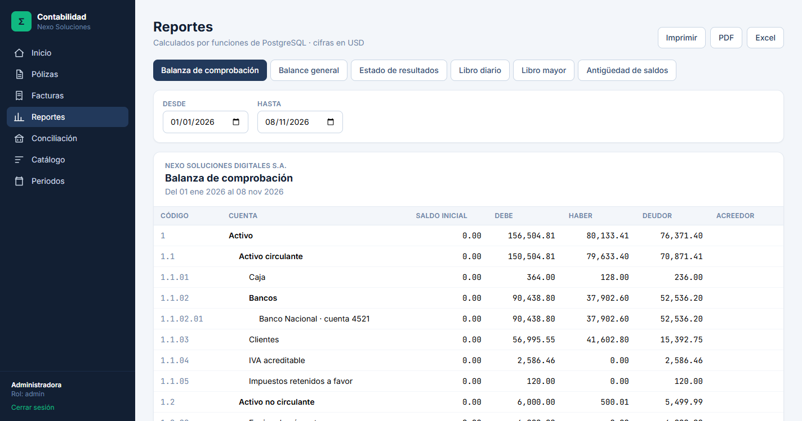 |
| 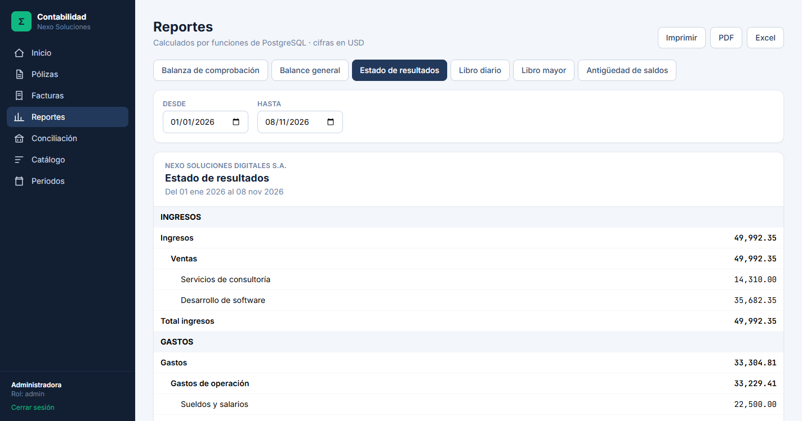 | 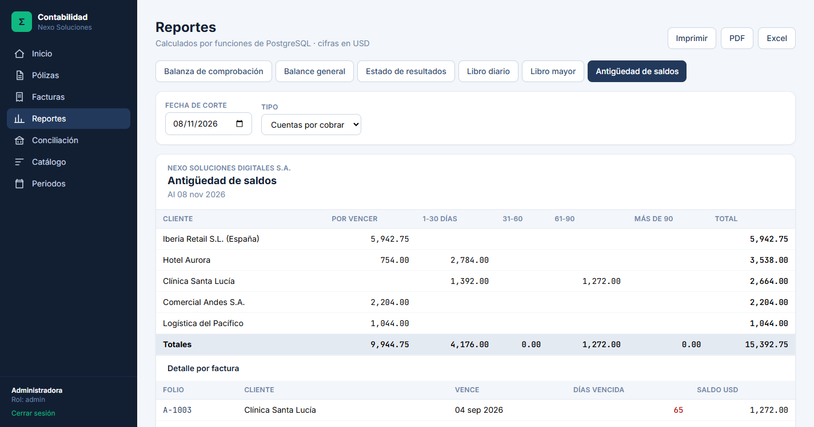 |
| 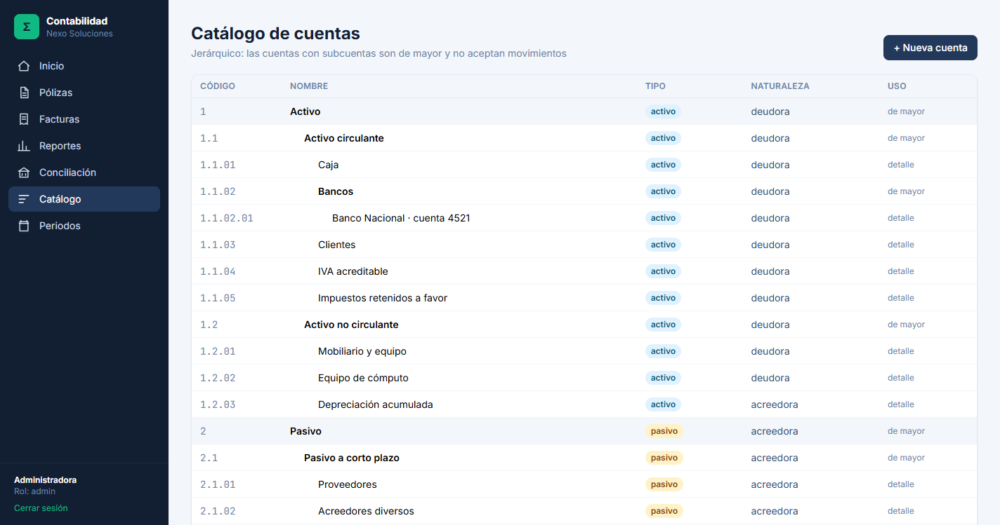 | 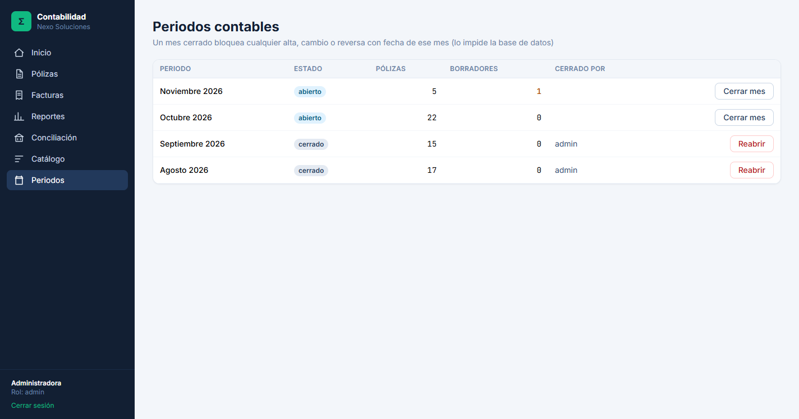 |
</details>

## ✨ Funcionalidades

| Módulo | Qué hace |
|---|---|
| **Catálogo de cuentas** | Jerárquico (activo, pasivo, capital, ingresos, gastos) con niveles y subcuentas. Una cuenta con subcuentas pasa a ser *de mayor* y deja de aceptar movimientos. |
| **Pólizas** | Partida doble: se rechaza cualquier póliza descuadrada. Borrador → contabilizada (con folio consecutivo por año) → cancelada solo mediante **póliza de reversa**. |
| **Libros** | Libro diario y libro mayor con saldo acumulado, generados al instante. |
| **Estados financieros** | Balanza de comprobación, balance general (activo = pasivo + capital) y estado de resultados por periodo. |
| **CxC y CxP** | Saldos por factura y antigüedad: por vencer, 1-30, 31-60, 61-90 y más de 90 días. |
| **Facturas** | De venta y de compra; al guardarlas se genera y contabiliza su asiento con IVA y retenciones. Cobros y pagos parciales. |
| **Impuestos** | Configurables: IVA 16 %, IVA 0 %, retención de ISR 10 % y retención de IVA, cada uno con su cuenta. |
| **Multimoneda** | Tipo de cambio por fecha; los pagos en moneda extranjera registran **utilidad o pérdida cambiaria**. |
| **Cierre de periodos** | Un mes cerrado no admite altas, cambios ni reversas (lo impide PostgreSQL). |
| **Conciliación bancaria** | Importa el estado de cuenta en CSV (sin duplicar), empareja automáticamente por importe y referencia o fecha, y permite registrar comisiones que solo aparecen en el banco. |
| **Exportación** | Todos los reportes en PDF y Excel, y versión imprimible desde el navegador. |
| **Usuarios** | Roles admin, contador y consulta (solo lectura), con JWT. |

## 🧮 Decisiones de diseño (las preguntas importantes)

### ¿Por qué `NUMERIC(18,2)` y nunca `FLOAT`?
`FLOAT` guarda los números en binario y no puede representar valores como 0.10 de forma exacta: en cualquier lenguaje `0.1 + 0.2 = 0.30000000000000004`. En contabilidad un centavo de diferencia descuadra una balanza. `NUMERIC` es decimal exacto. Por eso el sistema usa `NUMERIC(18,2)` en la base, `Decimal` en Python, y la API envía los montos **como texto** (`"1234.50"`) para que el navegador tampoco los convierta a `float`. El redondeo es comercial (0.005 → 0.01) y en moneda extranjera los centavos de redondeo se ajustan para que la póliza siga cuadrando en moneda base.

### ¿Por qué las pólizas son inmutables?
Una póliza contabilizada **no se edita ni se borra**: se cancela con una póliza de reversa (cargos y abonos invertidos) que deja huella de quién, cuándo y por qué. Lo hacen cumplir **triggers de PostgreSQL**, así que ni la API, ni un script, ni una consola SQL pueden alterarla. Las únicas transiciones permitidas pasan por las funciones `contabilizar_poliza()` y `revertir_poliza()`.

### ¿Por qué los saldos se calculan con funciones de PostgreSQL?
`saldos_cuentas()`, `libro_mayor()`, `balance_general()`, `estado_resultados()` y `antiguedad_saldos()` viven en la base (ver [`backend/sql/003_reportes.sql`](backend/sql/003_reportes.sql)):
- **Una sola consulta**: no se traen miles de líneas a Python para sumarlas.
- **Una sola fuente de verdad**: la pantalla, el PDF, el Excel y las pruebas usan exactamente la misma función.
- **Consistencia**: se calculan sobre una foto coherente de la base aunque otro usuario esté contabilizando.
- **Aritmética exacta** de extremo a extremo.

## 🏗️ Arquitectura

```
sistema-contabilidad/
├── backend/                     Python · FastAPI
│   ├── sql/
│   │   ├── 001_esquema.sql      tablas (montos NUMERIC(18,2))
│   │   ├── 002_reglas.sql       partida doble, inmutabilidad, periodos (triggers y funciones)
│   │   └── 003_reportes.sql     saldos, libros y estados financieros (funciones y vistas)
│   ├── app/
│   │   ├── servicios/           pólizas, facturas, reportes, conciliación, exportar (PDF/Excel)
│   │   ├── rutas/               endpoints REST
│   │   ├── seguridad.py         JWT y roles
│   │   └── seed.py              datos de demostración
│   └── tests/                   44 pruebas contra PostgreSQL real
├── frontend/                    React · Vite · TailwindCSS
│   └── src/paginas/             tablero, pólizas, facturas, reportes, conciliación...
└── docs/                        capturas, video, guía "cómo se hizo" y CSV de ejemplo
```

## 🚀 Instalación

**Requisitos:** Python 3.12+, Node 18+ y PostgreSQL 15+.

```bash
# 1. Base de datos
createdb contabilidad
createdb contabilidad_test

# 2. Backend
cd backend
python -m venv .venv
.venv\Scripts\activate              # Windows  (Linux/Mac: source .venv/bin/activate)
pip install -r requirements.txt
copy .env.example .env              # completa DATABASE_URL, TEST_DATABASE_URL y SECRET_KEY
python -m app.seed --reset          # crea las tablas y carga la empresa de demostración
uvicorn app.main:app --port 8000    # API en http://127.0.0.1:8000/docs

# 3. Frontend (otra terminal)
cd frontend
npm install
npm run dev                         # http://localhost:5173
```

### Usuarios de demostración

| Usuario | Contraseña | Rol |
|---|---|---|
| `admin` | `admin123` | Administrador (todo, incluido reabrir periodos) |
| `contador` | `contador123` | Captura y cierres |
| `consulta` | `consulta123` | Solo lectura |

La demo trae una empresa con 40 cuentas, 60 pólizas de agosto a noviembre de 2026, 26 facturas en USD y EUR, pagos parciales, una factura cancelada, una póliza corregida con reversa, agosto y septiembre cerrados, y un estado de cuenta bancario ([`docs/ejemplos/estado_cuenta_banco_nacional.csv`](docs/ejemplos/estado_cuenta_banco_nacional.csv)) ya conciliado salvo comisiones e intereses.

## 🧪 Pruebas

```bash
cd backend
python -m pytest
```

44 pruebas contra un **PostgreSQL real** (no SQLite: las reglas viven en triggers y funciones). Cada prueba corre en una transacción que se deshace al final.

| Archivo | Qué cubre |
|---|---|
| `test_partida_doble.py` | Póliza descuadrada rechazada en Python, en la base y en la API; líneas inválidas; cuentas de mayor; folios; redondeo multimoneda; máximo 2 decimales. |
| `test_inmutabilidad.py` | No se edita ni borra una póliza contabilizada (ni con SQL directo); reversa espejo; no se revierte dos veces; periodos cerrados; permisos por rol. |
| `test_reportes.py` | Escenario con cifras conocidas: balanza, balance (con depreciación acumulada como cuenta complementaria), estado de resultados, libro mayor, cierre de año y antigüedad por rangos. |
| `test_facturas_y_bancos.py` | Impuestos y retenciones, asiento automático, diferencia cambiaria, pagos parciales, cancelación, lectura de CSV, importación sin duplicados y conciliación. |

## 👩‍💻 Autora

**Anggie Alcedo** · [Portafolio](https://alcedoanggi-crypto.github.io) · [GitHub](https://github.com/alcedoanggi-crypto)

Desarrollado con apoyo de un asistente de IA. Licencia [MIT](LICENSE).
